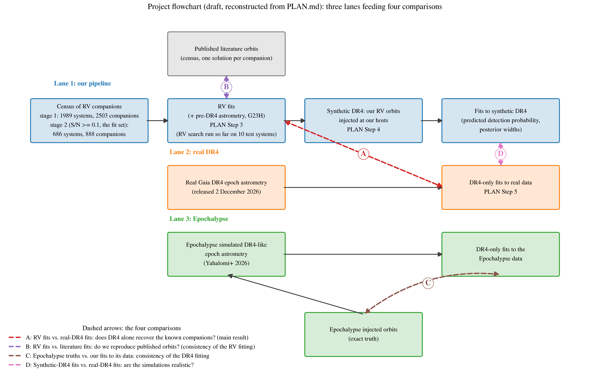
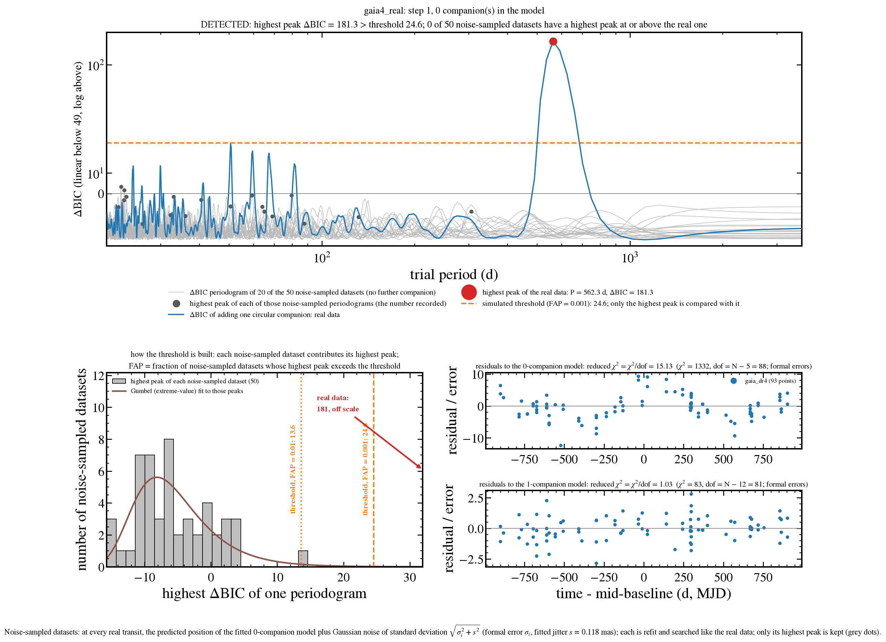
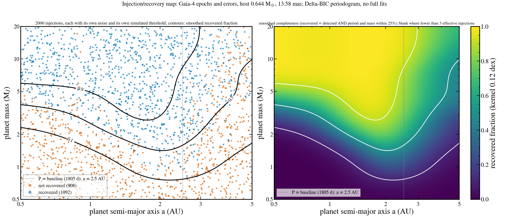

# Gaia DR4 sensitivity from known RV giant planets

*Did Gaia find the planets we think it should?* Gaia DR4 (released 2 December 2026)
will contain the epoch astrometry of every source. This project asks how reliably
DR4 alone recovers giant planets that radial velocities (RVs) already know about, and
turns the answer into an empirical sensitivity map. It also contains a standalone
tool, [`blind_search/`](blind_search/README.md), that finds companions blindly in
Gaia epoch astrometry.



*Project overview (draft): a census of RV companions, RV fits, synthetic and real DR4
fits, and the four comparisons (A-D) between them.*

## What is in the repository

| folder | contents |
|---|---|
| `sample/` | the census of RV companions (about 2700) and the study sample |
| `rv_data/` | RV collection from public archives, merged per system |
| `fits_rv/`, `configs/` | RV companion search and Octofitter fit pipeline |
| `data_conversion/` | Gaia DR4 pre-release epoch astrometry (12 sources) and converter |
| `blind_search/` | the blind companion search for Gaia astrometry (this page's quick start) |
| `tests/` | tests |

The science plan is in [PLAN.md](PLAN.md); open questions and decisions are in
[QUESTIONS.md](QUESTIONS.md); developer details are in
[DEVELOPER_NOTES.md](DEVELOPER_NOTES.md).

## Quick start: the blind companion search

**1. Install** (conda; Python 3.14), from the repository root:

```bash
conda env create -f environment.yml
conda activate gaia_dr4_sensitivity
python -I tests/test_blind_search.py --quick      # about 1.5 minutes, ends with "all passed"
```

**2. Run a search.** Save this as `my_search.py` in the repository root. The example
data are the Gaia-4 pre-release epoch astrometry (any Gaia epoch-astrometry CSV in the
archive layout works).

```python
import sys
sys.path.insert(0, 'blind_search')
import data, model, search


def main():
    channel = data.load_gaia_dr4('data_conversion/GaiaDR4_data_Gaia4.csv')
    result = search.run_search(model.Stack([channel]),
                               fap=1e-3,            # false-alarm probability per decision
                               out_dir='my_results', label='gaia4')
    for k, (P, e, M0) in enumerate(result['known'], start=1):
        print(f'companion {k}: P = {P:.1f} d, e = {e:.2f}')


if __name__ == '__main__':      # required: the search uses worker processes
    main()
```

```bash
python -I my_search.py          # about 10 s per step on a 12-core machine
```

It prints one line per step and stops at the first step with no detection:

```
  step 1: highest peak 181.3 at 562.3 d vs threshold 24.6 -> DETECTED  [9 s]
  step 2: highest peak -13.6 at 191.5 d vs threshold 11.4 -> not detected  [11 s]
companion 1: P = 577.4 d, e = 0.40
```

Gaia-4 b is found at step 1; nothing more is found at step 2. Each step also writes a
figure to `my_results/`:



*Top: the real periodogram (blue) against 20 of the noise-sampled periodograms (grey)
and the detection threshold (orange). Bottom left: how the threshold is built. Bottom
right: residuals before and after adding the companion.*

**3. Ask what the search can find** (injection/recovery map; about 95 minutes for 2000
injections, resumable):

```bash
python -I blind_search/injection_map.py run --n 2000 --out blind_search/results/my_map.jsonl
python -I blind_search/injection_map.py plot --out blind_search/results/my_map.jsonl
```



*Each dot is an injected planet (blue: recovered, orange: not). Contours show the
fraction recovered.*

More in [blind_search/README.md](blind_search/README.md).
