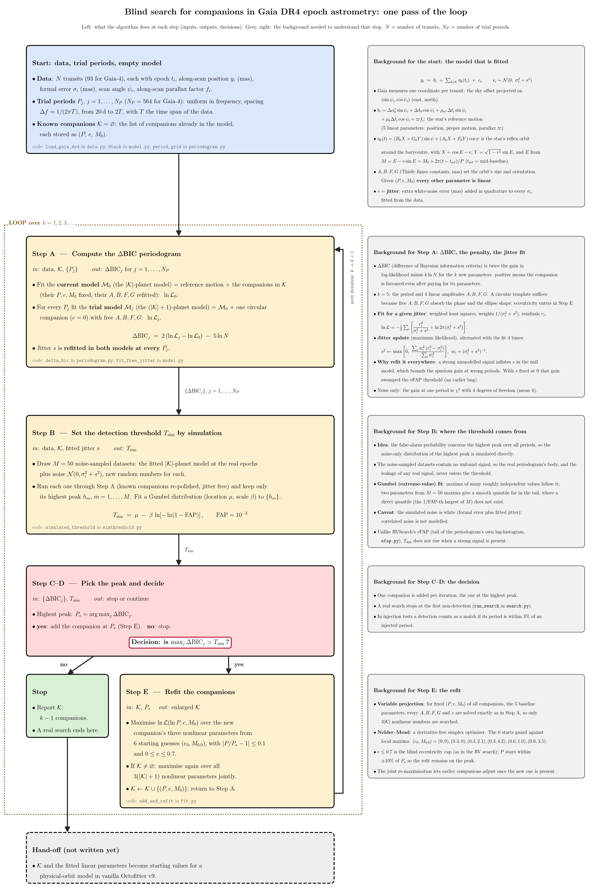
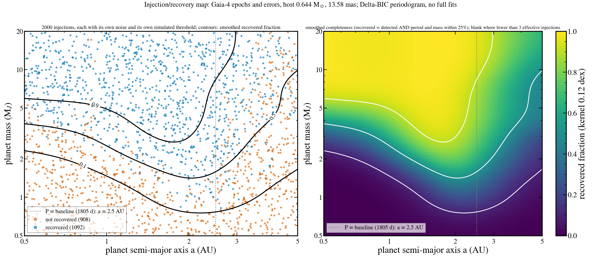

# blind_search: a blind companion search for Gaia epoch astrometry

A standalone Python tool (no Octofitter, no MCMC) that decides, from a star's Gaia
epoch astrometry, how many companions the data support and at which periods. It is
built around one question: *what detection threshold decides when to add a planet, so
that we neither miss real signals nor accept weak ones?* Gaia DR4 is released on
2026-12-02; until then the tool runs on the pre-release data in `data_conversion/` and
on simulated data with the same epochs and errors.

## How it works

The search adds companions one at a time. At each step:

1. **Periodogram.** For every trial period, fit the current model plus one more
   companion and record how much the fit improves (the Delta-BIC, larger is better).
2. **Threshold.** Draw 50 *noise-sampled datasets* from the current model, which
   contain no signal beyond noise, and compute the same periodogram for each. The
   highest peaks show how large a false alarm gets; the threshold is the level one
   false alarm in a thousand would exceed.
3. **Decision.** If the highest real peak exceeds the threshold, add a companion
   there, refit all companions, and repeat. Otherwise stop.

<a href="search_flowchart.png"></a>

*The full flowchart (click to enlarge).*

## What it can find

The injection/recovery map injects one planet at a time into noise at the Gaia-4
epochs and errors and records whether the search recovers its period and mass.



Out of 2000 injected planets (0.5-20 Jupiter masses, 0.5-5 AU), the search detects
every one with a signal-to-noise ratio (SNR) above 12 and half of those at SNR 6.4;
RVSearch's empirical threshold needs about SNR 16 for the same 50%.

## Reliability tests

`python -I blind_search/reliability_tests.py` (about 8 minutes) runs 12 checks; all
passed on 2026-11-13.

| test | what it checks | result |
|---|---|---|
| noise only | 45 datasets with no planet: does noise beat the threshold at the nominal rate? | yes (2 of 45 at the 10% level; p-values uniform) |
| detection | detection fraction versus SNR over the 2000 injections | none below SNR 4, 100% above 12 |
| multi-planet | one planet, two planets, a very faint planet, nothing | found as expected, no false detections |
| real data | Gaia-4 | Gaia-4 b found, nothing more |

## Run it

```bash
python -I tests/test_blind_search.py --quick      # unit tests, about 1.5 minutes
python -I blind_search/reliability_tests.py       # reliability tests, about 8 minutes
```

The root [README](../README.md) shows how to search your own data and how to build an
injection/recovery map.

## Limitations

- The noise is assumed white; correlated noise would raise the false-alarm rate.
- The injection map uses one circular companion per star.
- A companion can be missed if an earlier one was fitted poorly.

Terminology, module descriptions, compute costs, detailed test results and known issues
are in [DEVELOPER_NOTES.md](DEVELOPER_NOTES.md).
