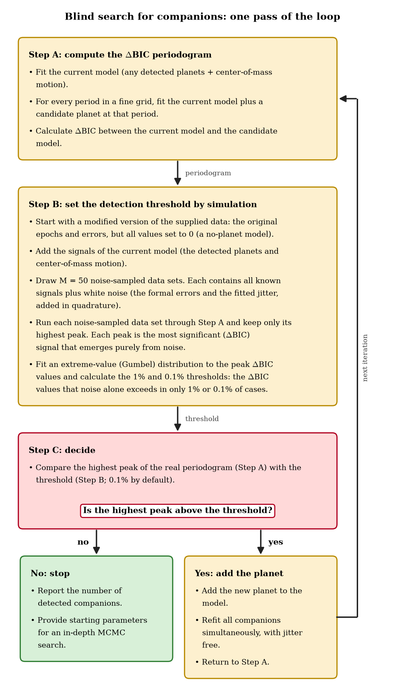

# blind_search: a blind companion search for Gaia epoch astrometry

A standalone Python tool that decides, from a star's Gaia epoch astrometry (its
measured position at each Gaia transit), how many companions the data support and at
which periods. All fits use least-squares optimization. The tool addresses one
question: *what detection threshold decides when to add a planet, so that real signals
are not missed and insignificant ones are not accepted?* Gaia DR4 is released on
2026-12-02; until then the tool runs on the pre-release data in `data_conversion/` and
on simulated data with the same epochs and errors.

## How it works

The search adds companions one at a time. At each step it:

- **A. Computes a periodogram.** For every trial period it fits the current model
  plus one candidate planet and records the improvement in the fit, the
  ΔBIC (change in the Bayesian information criterion; larger is better).
- **B. Sets the detection threshold by simulation.** It draws 50 *noise-sampled data
  sets* from the current model, which contain no signal beyond the known planets and
  noise, and computes the periodogram of each. Their highest peaks show how large a
  false alarm gets; the threshold is the level that noise alone exceeds in 0.1% of
  cases.
- **C. Decides.** If the highest real peak exceeds the threshold, it adds a planet
  there, refits all companions together, and repeats. Otherwise it stops and reports
  the companions found.



## What it can find

The injection/recovery map injects one planet at a time into noise with the epochs and
errors of Gaia-4 (a star with a known giant planet) and records whether the search
recovers its period and mass (code in [`injection/`](../injection/README.md)).


Among 2000 injected planets (0.5-20 Jupiter masses, 0.5-5 AU), the search detects
every planet with a signal-to-noise ratio (SNR) above 12 and half of those at SNR 6.4.
An alternative threshold estimated from each periodogram's own noise level needs about
SNR 16 for the same 50%.

## Reliability tests

`python -I validation/reliability_tests.py` (about 8 minutes) runs 12 checks; all
passed on 2026-11-13.

| test | what it checks | result |
|---|---|---|
| noise only | 45 data sets with no planet: does noise exceed the threshold at the stated rate? | yes (2 of 45 at the 10% level; p-values uniform) |
| detection | detection fraction versus SNR over the 2000 injections | none below SNR 4, 100% above 12 |
| multi-planet | one planet, two planets, a very faint planet, none | found as expected, no false detections |
| real data | Gaia-4 | its planet is found, nothing more |

## Run it

```bash
python -I tests/test_blind_search.py --quick      # unit tests, about 1.5 minutes
python -I validation/reliability_tests.py         # reliability tests, about 8 minutes
python -I validation/benchmark.py run             # benchmark systems
```

The root [README](../README.md) shows how to search your own data and how to build an
injection/recovery map.

## Limitations

- The noise is assumed white; correlated noise would raise the false-alarm rate.
- The injection map uses one circular-orbit companion per star.
- A companion can be missed if an earlier one was fitted poorly.
