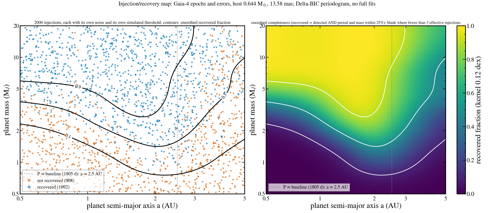

# injection: what can the search find?

Injects one planet at a time into noise with real Gaia epochs and errors, runs the
search's detection step on each, and records whether the planet's period and mass are
recovered (both within 25%). The result is a map of the recovered fraction over planet
mass and orbital separation.



*Each dot is an injected planet (blue: recovered, orange: not). Contours show the
fraction recovered.*

## Run it

```bash
python -I injection/injection_map.py run --n 2000      # about 95 minutes; resumable
python -I injection/injection_map.py plot
```

Results go to `injection/results/` (not in git), figures to `injection/figures/`.

| file | contents |
|---|---|
| `injection.py` | a physical companion (mass, period, e, angles, host mass, parallax) turned into the amplitudes the search fits |
| `injection_map.py` | the injection/recovery map |

## Limitations

- One circular-orbit companion per injection, on the Gaia-4 epochs only.
- White noise at the formal errors.
