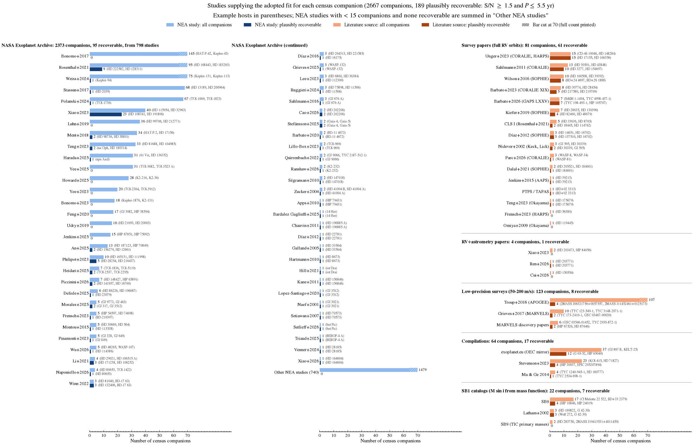

# Census of RV companions for the DR4 study

Rebuild everything from the cached downloads with one command, from the project root:

```
python -I sample/build_all.py              # every source table, literature.py, census.py, figures
python -I sample/build_all.py --refresh    # re-query the NEA, Gaia, VizieR, and lookup caches
```

`build_all.py` runs each source's `raw_lit/<source>/build.py`, then `literature.py --cached`,
`census.py --cached`, `census_plot.py`, `provenance_plot.py`, `lit_sources_plot.py`, and `sky_plot.py`.
The NEA and Gaia downloads in `raw/` are dated, with their query and checksum, in
`raw/SNAPSHOT.json`; `--refresh` replaces them and writes a new snapshot. The current
snapshot was taken on 2026-10-30, when the NEA solution table was re-queried with period,
SMA, and mass errors and the Gaia rows were refreshed. The NEA composite table and the
cone searches are unchanged since 2026-10-26.

Outputs:
- `census_table.csv`: one row per companion, full precision. `fit_type` (RV-only,
  RV+astrometry, or transit+RV) and `mass_type` (M sin i or true mass) describe each
  companion's solution; `solution_rule`, `pl_refname`, `pl_pubdate`, and `period_err_d`
  record how an NEA solution was chosen.
- Figures: `alpha_vs_period.png`, `snr_vs_period_by_distance.png`, `provenance.png`
  (a single panel with one stacked bar per host or companion parameter, segments labeled
  with their counts), `lit_sources.png`, and `sky_positions.png` (RA/Dec of every host,
  NEA vs. literature, with hosts of recoverable companions outlined).
  - `lit_sources.png` credits each companion to the study whose fit the census adopts
    (the NEA solution's reference, or the literature source), not the discovery paper.
    It shows census and recoverable companions per study, with up to two randomly drawn
    example hosts per bar. NEA studies with fewer than 15 companions and none
    recoverable are summed in one row, literature sources are grouped by tier, and bars
    are cut at 70 with the full count printed.
- `census_cut_companions.csv`: companions of census hosts that fail a cut (column `cut_reason`; mostly
  SMA > 5 AU). Not in the sample; the assisted RV fit of a fit-set system adds them back so its
  baseline RV model has every known companion.
- `no_rv_only_solution.csv`: the 94 NEA planets that lacked an RV-only solution under the
  earlier RV-only rule. It is no longer regenerated; 28 of them are now in the census.
- Printed summaries: `census_output.txt`, `census_plot_output.txt`, `sky_output.txt` (written by
  `build_all.py`; not in git).

Raw downloads are in `raw/` (NEA, Gaia) and `raw_lit/` (literature tables, SIMBAD IDs). The
literature search is summarized in [lit_search/README.md](lit_search/README.md).



## Sample cuts

Upper bounds only, so the sample reaches the regions where Gaia has poor sensitivity:
**M sin i ≤ 80 M_J** (the hydrogen-burning limit; the true mass where a solution gives
only that) **and SMA ≤ 5 AU** (SMA: semi-major axis), with no brightness limit.

## Sources

- **NASA Exoplanet Archive (NEA):** every planet with RV data (`rv_flag = 1`), up to the
  NEA's 30 M_J limit.
- **Literature:** 41 RV survey papers and catalogs, with precedence and vetting rules; see
  [lit_search/README.md](lit_search/README.md). Feng+2022 is excluded.
  - 745 literature entries duplicate NEA companions and are dropped.
  - 136 unvetted sub-13 M_J entries are set aside.
  - **294 literature companions** pass the cuts.

## Method

- **Solutions (amended 2026-10-30).** RV-only and RV+astrometry fits (Hipparcos-Gaia,
  Gaia DR2/DR3) are both eligible, since the recovery stage uses only DR4; the rule below,
  not the fit type, picks the preferred one. Every solution must use RVs. Excluded: Feng+2022 (in the NEA and
  as a literature source), whose fits are considered suspect, and the NEA's Gaia
  Collaboration (Arenou) et al. 2023 solutions, which are Gaia DR3 orbits without RVs.
  - A usable NEA solution has P or SMA and a mass. One that reports M sin i is RV-only;
    one that reports only a true mass for a non-transiting planet used astrometry.
    Transiting planets without either use their transit+RV solutions.
  - **Choice of NEA solution (decided 2026-10-30; replaces the archive default):**
    1. Per system, the newest paper with solutions for the most of its planets. Planets
       that paper doesn't cover take their own newest solution.
    2. If another solution, older or newer, has less than half the chosen one's period
       error, take it instead (the newest such solution), and repeat. Solutions without
       a nonzero period error are never compared.
    3. The chosen solution's P, SMA, e, K, ω, Tp, and M_* are used together.
  - Result: 2194 NEA companions take the newest paper for their system, 18 their own
    newest paper, and 161 a solution with a period more than 2× as precise (145 of them
    older). 538 companions changed from the archive-default rule, 29 of them recoverable.
    54 of 355 multi-planet hosts mix papers (68 under the old rule).
  - `mass_mj` is M sin i where the solution gives it, else the true mass. Literature
    RV+astrometry rows store M sin i (published, or the true mass times sin i).
- **Periastron times:** every Tp is converted to BJD_TDB (`Tp_bjd_tdb`). The original value
  and its time system are kept in `tp_raw` and `tp_system`, and `tp_flag` records the
  conversion:
  - JD and HJD are taken as UTC and converted with astropy, using the host's
    coordinates. The shifts run from −433 to +564 s for JD and are about 66 s for HJD.
  - BJD with no stated time scale, and values with no stated system, are taken as
    BJD_TDB. The possible error is up to about 70 s and 0.006 d, respectively.
- **Gaia DR3.** NEA hosts are matched by the archive's DR3 ID, with a positional fallback.
  Literature hosts are matched through SIMBAD, or through Gaia's 2MASS crossmatch for
  APOGEE stars. G and parallax come from DR3; distance = 1/parallax.
- **Stellar mass:** from the orbit source, else the NEA, else Gaia DR3 FLAME.
- **Signal:** α_min = (q/(1+q)) SMA / d, with q = M sin i / M_* (the true mass where only
  that is given).
- **Noise:** the per-FOV-transit error σ_FOV(G) from `gaiamock` (El-Badry et al. 2024).
  This is the per-CCD "EDR3 adjusted" curve of Holl et al. (2023, arXiv:2206.05439,
  Fig. 3) divided by √8. It rises for bright stars: σ_FOV ≈ 124 µas at G = 5, vs.
  46 µas at G = 10-13.
- **"Plausibly recoverable":** α_min/σ_FOV ≥ 1.5 (Lammers & Winn 2025, arXiv:2511.04673)
  and P ≤ 5.5 yr (the DR4 baseline), with the host present in Gaia DR3. This is a flag for
  the figures and tables, not a cut, and a rough estimate only. Lammers & Winn adopt
  P ≤ 4 yr instead: in their simulated DR4 orbit fits, the recovered period's mean error
  reaches 20% at P ≈ 4 yr (72% of the baseline). The figures mark 4 yr for reference;
  with that limit, 156 companions would qualify instead of 189.

## Provenance


| Parameter | Provenance (count) |
|---|---|
| Host Gaia DR3 match | NEA ID 1817 · SIMBAD/2MASS 293 · cone search 13 · suspect NEA ID 5 · absent 8 |
| Host G | Gaia DR3 2123 · NEA G 5 · NEA V 8 |
| Host distance | Gaia DR3 parallax 2120 · NEA parallax 13 · NEA distance 3 |
| Host mass | orbit solution or paper 2081 · NEA composite 47 · Gaia FLAME 8 |
| Companion orbit and mass | NEA RV-only 1003 · NEA RV+astrometry 141 · NEA transit+RV 1229 · survey paper 81 · RV+astrometry paper 4 · low-precision survey 123 · compilation 64 · mass-function M sin i 22 |
| NEA solution choice | newest paper for the system 2194 · newest paper for the planet 18 · >2× more precise P 161 |
| Companion Tp | BJD_TDB as published 66 · BJD with unstated scale 206 · converted from JD/HJD/BJD_UTC 279 · unstated system 225 · none 1891 |

Hosts absent from DR3 are six very bright giants (α Tau, α Ari, β And = HD 6860, β UMi,
γ¹ Leo, Pollux), Kepler-14, and SWEEPS-11.

Suspect NEA IDs:
- TOI-5261: the ID points to a G = 18.6 source with negative parallax.
- HD 133131 A, KOI-13, TOI-7265 B, OGLE-TR-56: G − V > 0.5, likely a companion star or a
  blend.

## Cut flow

| Cut | Companions | Hosts |
|---|---:|---:|
| NEA `rv_flag = 1`, plus new literature companions | 2945 | 2325 |
| Mass from a usable solution (RV-only, RV+astrometry, or transit+RV; no Feng+2022 or Gaia-only) | 2874 | 2280 |
| M sin i (or true mass) ≤ 80 M_J | 2826 | 2235 |
| SMA ≤ 5 AU | 2702 | 2168 |
| M_* and distance known | **2667** | **2136** |

The census has 2329 companions with M sin i ≤ 13 M_J and **338 brown dwarfs**: 55 at
13-20 M_J, 67 at 20-30, 88 at 30-50, and 128 at 50-80. (The usable-solution count rose
from 2834 because a transiting planet may now use any of its transit+RV solutions, not
only the archive default.)

## Counts

Forecast S/N vs. P/T_DR4 (T_DR4 = 5.5 yr):

| S/N | <0.1 | 0.1-0.5 | 0.5-1 | 1-2 | >2 | total |
|---|---:|---:|---:|---:|---:|---:|
| <0.1 | 1813 | 75 | 0 | 0 | 0 | 1888 |
| 0.1-0.5 | 99 | 183 | 26 | 8 | 1 | 317 |
| 0.5-1.5 | 37 | 92 | 42 | 15 | 0 | 186 |
| 1.5-5 | 22 | 34 | 41 | 31 | 2 | 130 |
| >5 | 17 | 45 | 32 | 49 | 3 | 146 |

Plausibly recoverable, by G:

| G | <6 | 6-8 | 8-10 | 10-12 | 12-14 | >14 | total |
|---|---:|---:|---:|---:|---:|---:|---:|
| Companions | 176 | 477 | 571 | 692 | 494 | 257 | 2667 |
| Recoverable | 15 | 69 | 62 | 24 | 12 | 7 | **189** |

By distance:

| Distance | Companions | Recoverable | Near threshold (S/N 0.5-1.5, P ≤ 5.5 yr) |
|---|---:|---:|---:|
| < 30 pc | 463 | 39 | 33 |
| 30-100 pc | 750 | 113 | 83 |
| 100-300 pc | 713 | 33 | 32 |
| > 300 pc | 741 | 4 | 23 |

The 189 recoverable companions orbit 185 hosts. All but two were discovered by RV; Gaia-4 b
and Gaia-5 b were discovered by Gaia astrometry.
- Sources: 95 from the NEA and 94 from the literature.
- 105 are brown dwarfs, 49 of them at 50-80 M_J.
- Distances: 10th, 50th, and 90th percentiles are 17, 49, and 138 pc.

## Error columns and precision flags (added 2026-11-06)

`census_table.csv` ends with columns that record each companion's uncertainties and how
they were obtained. All of them are derived, so they never change which companions are in
the census. Every place the table is shown should say which values are derived.

| Column | Meaning |
|---|---|
| `period_err_d` | Period error as published (the NEA's or the literature source's). `period_err_filled_d` and `period_err_source` add one derived from the published SMA error where the period has none. |
| `st_mass_err`, `st_mass_err_source` | Stellar-mass error and where it came from: published (orbit source or NEA composite), Gaia FLAME bounds, or a **stand-in** fractional error (the median among stars of similar mass that have one, from `st_mass_err_standin.csv`). |
| `sma_err_au`, `sma_err_source` | SMA error: published, or **derived from P and M_\***. |
| `mass_err_mj`, `mass_err_source`, `msini_err_from_K` | Mass (or M sin i) error: published (the NEA's, or the source paper's), or **derived from K** (with P, e, and M_* terms) where only a K error exists; `msini_err_from_K` marks those. |
| `p_sigma`, `orbit_sigma`, `mass_sigma` | P/σ_P; the orbit measure used (P, else the published SMA over its error); mass/σ_mass. |
| `orbit_precise`, `mass_precise`, `precise` | At >= 3σ. **A missing or zero error passes** ("innocent until proven guilty"). |
| `precision_unverified`, `missing_errors` | Passed only because an error is missing; and which error (orbit, mass, or both) no route could supply (listed in `missing_errors.csv`). |

Counts (2026-11-06, after the source papers' errors went in): 2435 of 2667 companions are
`precise`, 105 of them unverified. Mass errors: 2449 published, 152 derived from K, 66
missing. SMA errors: 2105 published, 455 derived, 107 missing. Period errors: 2535
published, 25 derived from the SMA error, 107 missing. 149 companions lack an orbit or
mass error that no route could supply (`missing_errors.csv`). Systems selected for the
study (stage 1, stage 2, resonance flag): `catalog.py` and PLAN.md, Step 1b.

## Why some "easy" companions aren't recoverable

246 companions have P ≤ 5.5 yr and α_min above the best-case threshold (69 µas, for
G = 10-13); 189 are recoverable. The other 57 miss for these reasons:
- 30: host brighter than G = 6.
- 15: host in the `gaiamock` error bump at G = 6-8.4.
- 7: host fainter than G = 13.
- 5: host absent from DR3.

## What this means for the study

1. **Recoverable: 189 companions** (156 with Lammers & Winn's 4-yr limit). Another 80
   have S/N ≥ 1.5 with 5.5 yr < P ≤ 11 yr.
2. **The threshold region is well sampled.** 171 companions have S/N 0.5-1.5 and
   P ≤ 5.5 yr, and 2205 have S/N < 0.5, which should be clean non-detections.
3. **Brightness is the main reason high-signal companions miss the threshold.**

## Caveats

- Literature and NEA values are taken as given from the chosen solution, except SMA
  (decided 2026-11-04): where a published SMA disagrees by more than 20% with Kepler's law
  for the solution's P and total mass (M_* + M sin i), the Kepler value replaces it
  (`sma_source`). This affects 21 companions, none of whose recoverable flags changed.
  - The period wins correctly for typo-level SMAs (HAT-P-7 b: 3.0 AU vs. 0.037 AU;
    KOI-2513.01, XO-6 b, TIC 172900988 b, NGTS-31 b, K2-285 c).
  - For 11 Stassun+2017 solutions the published SMA is right and Stassun's M_* is wrong
    (e.g., 0.39 M_sun for HD 20868, whose SMA implies 0.79; 8.76 M_sun for HD 240237), so
    the Kepler SMA inherits the bad M_*. The NEA composite table adopts the same masses.
  - Kepler-34 b and Kepler-35 b are circumbinary, so their SMAs use the binary's mass.
  - Cha Hα 8 b and PPL 15 b (exoplanet.eu) orbit brown dwarfs; their published SMAs imply
    a total mass below the host's.
- The 2× period-precision rule can pick an older orbit whose period has since been
  revised: 41 of its 161 switches disagree with the newest paper's period at > 3σ (e.g.,
  ε Eri b, GJ 3512 c, HIP 14810 c, HD 47536 b).
- Duplicates are resolved before the cuts, so a higher-precedence entry that then fails a
  cut can displace a usable one. Known case: HD 127506 (HIP 70950), where Cui+2026's
  orbit (no stellar mass) displaces SB9's, and neither is in the census.
- σ_FOV(G) is a DR3-based model; DR4 calibration may differ, especially for bright stars.
- The thresholds come from Lammers & Winn's simulations, not real DR4 data.
- Low-precision literature orbits (Troup+2016, MARVELS) make up 123 census entries, 8 of
  them recoverable.
