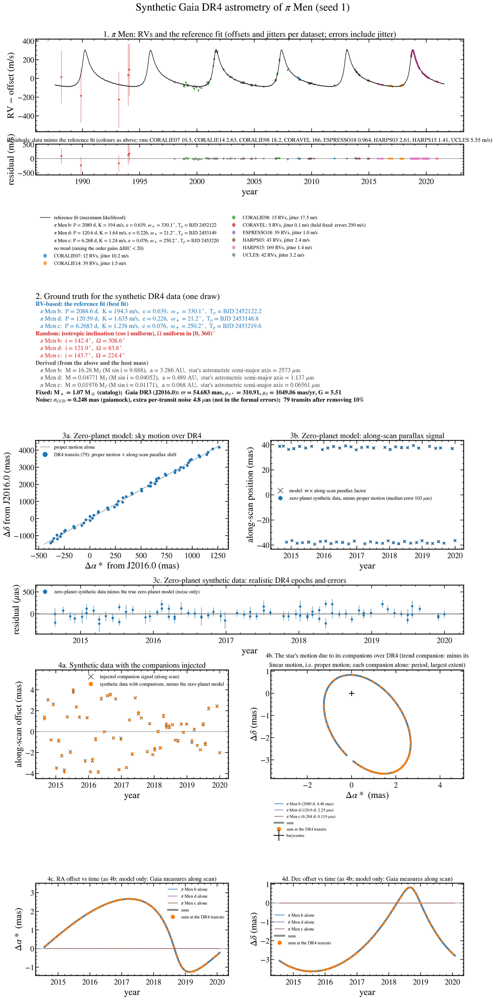

# validation: benchmarks and reliability tests

Checks that the blind search behaves as intended, on data whose answer is known.

## Benchmarks

Synthetic Gaia DR4 data of known RV systems, five random seeds each. The planets' RV orbits
(period, eccentricity, phase, semi-amplitude) are the best fit to the real RVs; a known planet
the RVs do not detect keeps its published (NEA) orbit. The inclination and node are drawn at
random. Where the RVs need a long-term trend or an extra long-period orbit, a distant companion
that reproduces it is drawn and its acceleration added: real DR4 data will carry such motion on
top of the planets. It is not a target of the search. Gaia's scanning law and error model
(`gaiamock`) give realistic epochs and noise. The datasets are frozen in `benchmarks/`,
so every version of the search runs on identical data.



Sizes below are the star's astrometric wobble (seed 1).

| system | what it tests |
|---|---|
| π Men | strong long-period planet (b, 2.6 mas); the two inner planets (≤ 1 µas) must not be claimed |
| HD 111232 | moderate planet (b, 0.8 mas) beside a wide known companion (c, 46 yr) |
| HD 168443 | strong outer planet (c, 1.3 mas); weak inner planet (b, 57 µas); an extra 27 yr orbit from the RVs |
| HD 89707 | very high eccentricity (b, e = 0.95) |
| TOI-1736 | weak planet (c, 0.14 mas); linear RV trend |
| TOI-1694 | planets far below Gaia's reach (≤ 10 µas): nothing should be found |
| HD 147513 | weak planet (b, 0.14 mas); quadratic RV trend |
| μ Ara (HD 160691) | four planets: b (0.21 mas), c (1.3 mas), e (27 µas), d |
| HD 191939 | six planets; only f (0.37 mas) is within reach |
| HD 94340 | strong planet (b, 2.8 mas) with a 6.8 d companion (0.11 mas) |
| 70 Vir | one planet (b, 0.20 mas, 117 d) |
| HD 10180 | six low-mass planets (≤ 23 µas) and a linear RV trend |
| HD 43691 | one small signal (b, 24 µas, 37 d) |

The list and the search settings are in `benchmarks.toml`.

```bash
python -I validation/benchmark.py generate    # make datasets listed but missing (never overwrites)
python -I validation/benchmark.py run         # search them; products in validation/results/ (not in git)
python -I validation/benchmark.py redraw      # redraw every figure from saved products, no search
python -I validation/benchmark.py compare     # table against the stored reference results
```

## Reliability tests

```bash
python -I validation/reliability_tests.py     # 12 checks, about 8 minutes
```

Noise alone exceeds the threshold at the stated rate; injected planets are found as
expected; the real Gaia-4 planet is found and nothing more.

| file | contents |
|---|---|
| `synthetic_dr4.py` | makes a benchmark dataset and its figure |
| `benchmark.py`, `benchmarks.toml` | runs, redraws and compares the benchmarks |
| `reliability_tests.py` | the reliability tests |
| `rv_hd191939.py` | the RV-only search of HD 191939 |
